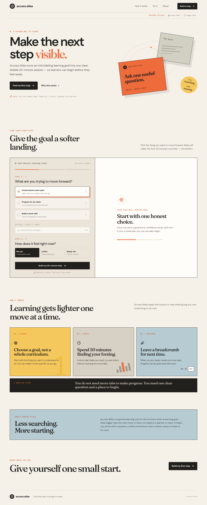
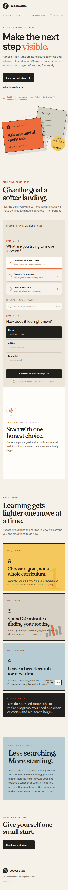

# Access Atlas — Make the next step visible

Access Atlas turns an intimidating learning goal into one clear, doable 20-minute session so a learner can begin before they feel ready.

## The problem
Learning resources often assume the learner already knows where to start. For an adult learner returning to study, dense explanations, unfamiliar vocabulary, and too many possible resources can create cognitive overload and poor wayfinding. Access Atlas addresses the uncertainty before adding more content.

## Who it is for
Access Atlas is designed for adult learners returning to study, preparing for an exam, or building a work skill. The current examples are synthetic and do not use private student records or real grades.

## What it does

- Offers three starting goals: understand a new topic, prepare for an exam, or build a work skill.
- Accepts an optional learner-owned topic or goal.
- Builds a hand-authored 20-minute micro-plan.
- Adapts the language and practice emphasis to three confidence levels: Not yet, A little, and Ready-ish.
- Reveals one follow-up practice step only when the learner is ready.
- Supports a short manageability reflection.
- Lets the learner copy the plan or print/save it as a PDF.
- Includes Focus view and Larger text controls for a calmer reading experience.

### Adaptive learning and accessibility modes
The adaptive logic is deliberately transparent and rule-based. The selected goal chooses a learning path, the optional custom goal personalizes the first step, and the confidence level changes specific plan actions. “Not yet” uses smaller, simpler actions; “A little” uses the baseline plan; “Ready-ish” adds outcome-setting and a practice check.

The current accessibility controls include Focus view, which removes the decorative hero artwork and expands the main content area, and Larger text, which increases the reading scale. The accessibility roadmap and known gaps are documented in [`docs/ACCESSIBILITY.md`](docs/ACCESSIBILITY.md).

## Screenshots





## Live demo

[Open the live Access Atlas demo](https://accessatlas-7kw8kcsw.manus.space)

### First-time demo steps

1. Choose **Understand a new topic**.
2. Enter a topic such as `understand percentages` in the optional field.
3. Select **Not yet**, **A little**, or **Ready-ish**.
4. Choose **Build my 20-minute step**.
5. Compare the generated first step and micro-plan.
6. Try **Focus view**, **Larger text**, **I’m ready for the next step**, and **Copy plan**.

## Tech stack and architecture

The frontend uses React, TypeScript, Vite, Tailwind CSS, and lucide-react. The repository also contains the managed Express, tRPC, Drizzle, and Manus platform scaffolding used for authentication, health checks, platform services, storage, and future product routes.

The current learner flow is client-side and does not require an account, database, or API key. Learning paths are defined in `client/src/pages/Home.tsx`; the app shell is in `client/src/App.tsx`; global design and responsive behavior are in `client/src/index.css`; server and platform routes live in `server/` and `shared/`.

## Run locally

Requirements: Node.js 22+, pnpm 10.18.0, and a Git checkout.

```bash
pnpm install --frozen-lockfile
pnpm dev
```

The development server listens on `PORT` or `3000` by default.

Useful commands:

```bash
pnpm check          # TypeScript validation
pnpm test           # Vitest suite
pnpm build          # Vite frontend + Express server bundle
pnpm start          # Serve the production bundle
pnpm build:static   # Static frontend build used by Preview
```

The platform scaffolding recognizes these environment variable names when the related services are enabled: `PORT`, `DATABASE_URL`, `MANUS_PROJECT_ID`, `MANUS_API_URL`, `MANUS_API_KEY`, `MANUS_API_BROWSER_KEY`, `MANUS_JWT_SECRET`, `OWNER_OPEN_ID`, `MANUS_ANALYTICS_ENDPOINT`, and `MANUS_ANALYTICS_WEBSITE_ID`. Never commit their values. See [`.env.example`](.env.example) for names only.

Database commands are only needed when a database is enabled and configured:

```bash
pnpm db:migrate
pnpm db:push
```

## How the adaptive logic works

The current system is a transparent rule set rather than a trained model. A goal selects one of three hand-authored paths. A custom goal changes the wording of the first action. Confidence changes the action language and practice emphasis while keeping the session at 20 minutes.

Example:

- Before: `Learn percentages`.
- Not yet: `Make the question smaller` and circle one unfamiliar word.
- Ready-ish: `Name the outcome` and try a fresh example without looking back at the notes.

The detailed inputs, rules, and outputs are documented in [`docs/ADAPTIVE_LEARNING.md`](docs/ADAPTIVE_LEARNING.md).

## Limitations and what is next

The current MVP does not measure correctness, completion, time spent, or long-term progress. It does not persist plans or reflections, connect to a curriculum provider, or replace a teacher, tutor, or accessibility specialist. Learning paths are hand-authored and only cover three starting goals.

Next steps should be guided by permission-cleared user testing: measure time to first action, perceived manageability, session completion, and whether the learner can name a next step. Future product work could add persisted learner plans, teacher-reviewed paths, more robust accessibility preferences, and curriculum integrations without turning the experience into a content dump.

## How it was built

This project was scaffolded and built with an AI agent (Manus). The product-specific flow, copy, visual system, adaptive rules, accessibility controls, and documentation were iterated in the project repository.

**My design, decisions, and testing:** _[Project owner: describe what you designed, decided, and tested yourself here. Do not leave this placeholder in the final submission.]

## License

This project is licensed under the MIT License. See [`LICENSE`](LICENSE).
